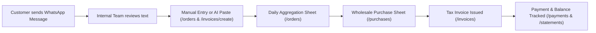

# LedgerFlow — Smart Invoicing, Purchasing & Accounting System

> **A modern, responsive business management application** tailored for wholesale produce suppliers, food distributors, and small businesses to manage WhatsApp-driven daily orders, inventory aggregation, invoicing, payments, VAT liabilities, and client financial statements.

---

## 🌟 Key Highlights & User Roles

LedgerFlow provides **3 dedicated user experiences** based on organizational responsibilities:

### 1. 👑 Business Owner / Admin
- **WhatsApp Order Entry:** Internal staff manually enter customer daily produce orders received via WhatsApp or paste raw messages into the AI text-parser modal.
- **Daily Wholesale Aggregation:** Automatically sums all confirmed customer orders into a morning wholesale purchasing requirement sheet with item fulfillment tracking.
- **Invoice Generation & VAT:** Generate itemized tax invoices with UK Standard 20% and Zero-Rated 0% produce rates, discounts, and payment terms.
- **Payment & Outstanding Tracking:** Record customer remittances across Bank Transfer, Square POS, and cash while maintaining real-time customer balances.
- **Supplier Purchases & Operational Settings:** Manage wholesale supplier purchase bills and configure company details, bank remittance info, and invoice sequence counters.

### 2. 🧮 Accountant / Auditor
- **Financial Dashboard:** Live revenue inflows, uncollected receivables, and tax liability metrics.
- **Financial Ledgers:** Access to all customer invoices, payments, and client directory.
- **Customer Account Statements:** Generate formal debit/credit running balance statements with print/PDF layout and CSV export.
- **Income & Expenses (P&L):** Track gross sales against wholesale stock and operating overheads with interactive monthly performance charts.
- **HMRC MTD VAT Return:** Real-time quarterly output VAT (collected) vs input VAT (paid) calculation.
- **Audit Reports:** Exportable sales, purchasing, payment, and aging receivables reports.

### 3. 🏢 Customer Portal (Client Self-Service)
- **Isolated Account Overview:** View company profile, contact details, payment terms, and live outstanding balance.
- **My Invoices:** View all issued tax invoices with live payment status (Paid, Overdue, Partially Paid) and open full itemized printable previews.
- **Payment Receipts:** Complete historical log of recorded remittances with payment methods and reference IDs.
- **Statement of Account:** Access formal statement of account with running balance and company bank remittance instructions (Sort Code, Account Number).
- 💡 **WhatsApp Ordering Note:** Clearly notifies customers that daily produce orders are handled directly through WhatsApp by their team members, eliminating confusion.

---

## 🔄 WhatsApp Order-to-Invoice Workflow



---

## 🛠️ Technology Stack

- **Frontend Framework:** [React 19](https://react.dev/) + [Vite](https://vitejs.dev/)
- **Styling & Design System:** [Tailwind CSS](https://tailwindcss.com/) + Custom Glassmorphic & Modern UI Tokens
- **Icons:** [Lucide React](https://lucide.dev/)
- **Charts & Analytics:** [Recharts](https://recharts.org/)
- **Routing:** [React Router v7](https://reactrouter.com/)
- **State Management:** React Context (`AppContext`) with automatic `localStorage` persistence

---

## 📂 Project Directory Structure

```
frontend/
├── public/                  # Static assets
├── src/
│   ├── assets/              # Icons & SVG assets
│   ├── components/
│   │   ├── accounting/      # Transaction tables & entry modals
│   │   ├── customers/       # Customer table & form modals
│   │   ├── dashboard/       # Metric cards, sales charts, recent activity
│   │   ├── invoices/        # Invoice tables, AI parser modal, payment modals
│   │   ├── layout/          # Sidebar, Topbar, MobileNav, PageHeader, AppLayout
│   │   ├── orders/          # Aggregation sheet & daily order modals
│   │   └── ui/              # Buttons, Cards, Modals, Badges, Tabs, Inputs
│   ├── context/
│   │   └── AppContext.jsx   # Global store for entities, auth, and business settings
│   ├── data/
│   │   ├── mockCustomers.js # Default customers with portal credentials
│   │   ├── mockInvoices.js  # Sample sales invoices
│   │   ├── mockOrders.js    # Sample daily orders & aggregations
│   │   ├── mockPayments.js  # Payment records
│   │   ├── mockProducts.js  # Produce inventory list & rates
│   │   ├── mockPurchases.js # Supplier purchase bills
│   │   └── mockTransactions.js # Income, expense, and business settings
│   ├── pages/
│   │   ├── accounting/      # IncomeExpenses.jsx & VAT.jsx
│   │   ├── auth/            # Login.jsx with 1-click role presets
│   │   ├── customers/       # Customers.jsx & CustomerDetails.jsx
│   │   ├── invoices/        # Invoices.jsx, CreateInvoice.jsx, InvoiceDetails.jsx
│   │   ├── orders/          # DailyOrders.jsx (Aggregation Sheet)
│   │   ├── payments/        # Payments.jsx
│   │   ├── portal/          # CustomerPortal.jsx (Isolated Client View)
│   │   ├── purchases/       # Purchases.jsx
│   │   ├── reports/         # Reports.jsx
│   │   ├── settings/        # Settings.jsx (Profile, Tax, Bank, WhatsApp simulation)
│   │   └── Dashboard.jsx    # Primary Executive Dashboard
│   ├── routes/
│   │   └── AppRoutes.jsx    # Application route definitions & guards
│   ├── utils/               # Currency, date formatting, and CSV export utilities
│   ├── App.jsx              # Main App wrapper
│   └── main.jsx             # React DOM entry point
├── package.json             # Dependencies and scripts
└── vite.config.js           # Vite build configuration
```

---

## 🚀 Getting Started Locally

### Prerequisites
- [Node.js](https://nodejs.org/) (version 18+ recommended)
- `npm` or `yarn`

### Installation & Run

1. **Clone or navigate to the directory:**
   ```bash
   cd d:/Kiaan/invoice/frontend
   ```

2. **Install dependencies:**
   ```bash
   npm install
   ```

3. **Start the local development server:**
   ```bash
   npm run dev
   ```

4. Open your browser and navigate to:
   ```
   http://localhost:5173
   ```
   *(or the port indicated in your terminal)*

---

## 🔑 Quick Demo Login Credentials

The login screen includes **one-click presets** to instantly test each role:

| User Type | Demo Email | Access Level | Target View |
|---|---|---|---|
| **Business Owner / Admin** | `admin@freshharvest.co.uk` | Full Access | `/dashboard` |
| **Accountant / Auditor** | `accounts@freshharvest.co.uk` | VAT & Ledgers | `/dashboard` (Accountant View) |
| **Customer (Client)** | `accounts@greenvalley.co.uk` | Green Valley Portal | `/portal` |

*Demo Password:* `password123`

---

## 📱 Responsive Design Standards

- **Mobile Viewports (< 640px):** Fixed bottom navigation bar (`MobileNav`), responsive 2-column KPI grids, and slide-in drawer menu.
- **Tablet (640px – 1024px):** 3-column / 4-column balanced layouts.
- **Desktop (1024px+):** Full collapsible sidebar with hover micro-animations and wide-screen data tables with horizontal swipe support.
- **Print & PDF:** Built-in `@media print` styling for clean, professional invoice and statement printouts.
